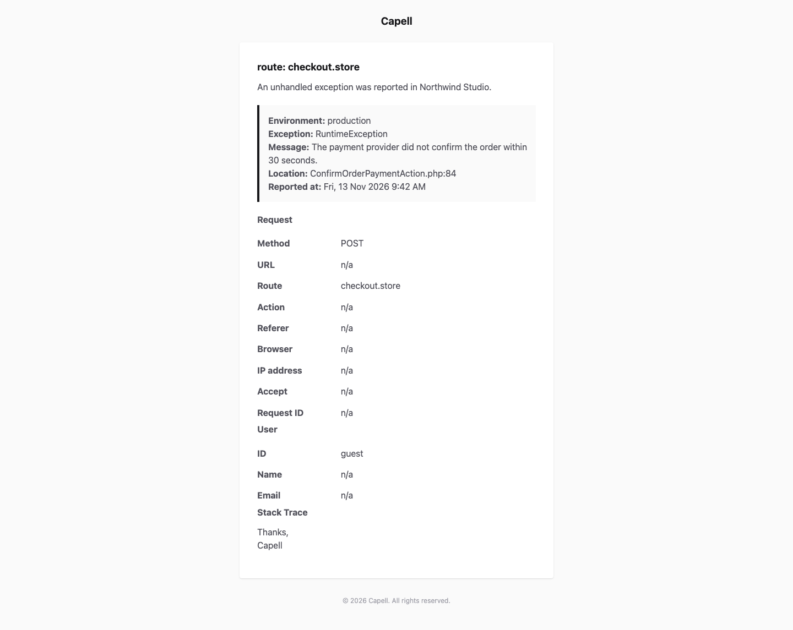

# Exception Reports

<!-- prettier-ignore-start -->

The client rings to say the checkout page is broken, and it's the first you've heard of it. With this, a crash on your site emails you, usually before the phone rings. It reacts to unhandled exceptions, errors the site didn't deal with, that Laravel (the framework behind Capell) reports.

The email goes to your site's sending address, and picking another needs a developer because the admin has no setting for it. There's no page of errors or way to mark one resolved. Each exception is also saved as a small database record, hidden from the admin and deleted after 30 days by default, if your server's scheduler is running. A retention of 0 in server settings keeps them forever. If a developer sets one up, the same report can go to a webhook, an approved web address for your own tools.

By default, identical errors send one email every 15 minutes, and at most ten emails go out an hour. Anything held back is saved but not emailed.

Each email names the error, the file and line, and the environment. It names the page or command by its internal name, not its web address. The subject line carries your app name, the error type and that page or command, so you know where the trouble is before opening it.

- **Price and availability:** Check current availability and price on the [Capell Marketplace listing](https://capell.app/marketplace/extensions/exception-reports).
- **Licence:** Check the licence terms on the [Capell Marketplace listing](https://capell.app/marketplace/extensions/exception-reports).
- **Requires:** `PHP ^8.4`, `capell-app/core ^1.0.79`, `laravel/framework ^12.61.1|^13.12.0`, `lorisleiva/laravel-actions ^2.8`, `spatie/laravel-package-tools ^1.14.1`.
- **Install:** `composer require capell-app/exception-reports:@beta`.

## Quick Start

1. Install the package: `composer require capell-app/exception-reports:@beta`.
2. Run `php artisan list capell` and confirm these commands are listed: `capell:exception-reports-prune`. Run any of them with `--help` to see its options.

## For Developers

A typed report boundary and sanitizer keep request secrets out of queued payloads, while trace, identity, IP, and route-parameter details remain opt-in.

## Configure

- **Configuration files:** `config/capell-exception-reports.php`.
- **Commands:** `php artisan capell:exception-reports-prune`.

## Limits And Pitfalls

- Install the required Capell packages at the versions in `composer.json`: `capell-app/core ^1.0.79`.
- Run migrations before opening package resources or public routes.
- Keep the host Laravel scheduler running so package-registered schedules can execute: `capell:exception-reports-prune (daily; package registered)`.

## Screens And Workflow

- Exception Reports extension card (marketplace).
- Exception report email rendered from the package mailable (frontend).

## Install Impact

- Required packages: `capell-app/core`.
- Admin navigation: no admin page or resource contribution is declared.
- Admin/editor extensions: none declared.
- Permissions: no package permission declarations or Shield gates detected; host access rules still apply.
- Public routes: none declared.
- Database changes: package migrations are declared.
- Config: `config/capell-exception-reports.php`.
- Settings: no package settings declared.
- Queues or schedules: scheduled commands `capell:exception-reports-prune (daily; package registered)`.
- Cache tags: none declared.
- Commands: `capell:exception-reports-prune`.

## Troubleshooting

| Symptom | Likely cause | Check | Fix |
| --- | --- | --- | --- |
| Package surface is missing after install | Provider or manifest is not loaded | Confirm `capell.json`, package `composer.json`, and provider registration | Reinstall the package, refresh Composer autoload, and clear host caches |
| Admin screen or command fails on missing table | Package migrations have not run | Check the tables listed in `Data Model` | Run host migrations and rerun the focused package test |
| Background work does not run | Queue worker or declared schedule is not active | Check the jobs and scheduled commands listed in `Technical Shape` | Start the queue worker or host scheduler, then run the focused command or package test |

## Upgrading

No manual steps between minor versions.

Read [CHANGELOG.md](CHANGELOG.md) before upgrading.

## Next Steps

- [Package docs](docs/README.md)
- [Overview](docs/overview.md)
- [Worked extension examples](docs/extension-contracts.md)
- [Worked action walkthroughs](docs/extension-examples.md)
- [Admin guide](docs/admin-guide.md)
- Configuration files: [`config/capell-exception-reports.php`](config/capell-exception-reports.php).
- [Troubleshooting](#troubleshooting)
- [Developer reference](docs/reference.md)
- [Marketplace assets](docs/assets/marketplace/)
- [Capell content language plan](../../docs/CONTENT_LANGUAGE_PLAN.md)
- [Capell documentation design system](../../docs/DESIGN_SYSTEM.md)
- [Capell and package ERD notes](../../docs/erd/capell-and-package-erds.md)
- Related packages: [Diagnostics](../diagnostics/README.md).

<!-- prettier-ignore-end -->
