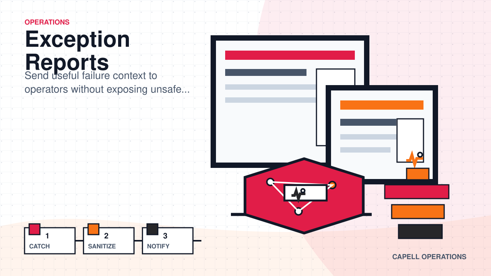

# Exception Reports

<!-- prettier-ignore-start -->

## What It Does

Exception Reports queues sanitized unhandled-exception reports to configured email recipients and optional signed webhook endpoints, with rate limiting and grouped digests.

- **Price and availability:** Check current availability and price on the [Capell Marketplace listing](https://capell.app/extensions/exception-reports).
- **Licence:** Check the licence terms on the [Capell Marketplace listing](https://capell.app/extensions/exception-reports).
- **Requires:** `PHP ^8.4`, `capell-app/core ^1.0.75`, `laravel/framework ^12.61.1|^13.12.0`, `lorisleiva/laravel-actions ^2.8`, `spatie/laravel-package-tools ^1.14.1`.
- **Install:** `composer require capell-app/exception-reports`.

Operators receive a sanitized email or webhook payload for triage. The package has no admin resource; recipients, privacy options, and delivery behaviour are configured at application level.

## Who It Is For

**For developers:** A typed report boundary and sanitizer keep request secrets out of queued payloads, while trace, identity, IP, and route-parameter details remain opt-in.

**For teams:** Operational failures reach the configured owner with enough context to start triage, and repeated signatures can be rate limited or summarised instead of producing duplicate alerts.

## Quick Start

1. Install the package: `composer require capell-app/exception-reports`.
2. Verify the package provider and manifest contributions are registered in the host app.

## Configure

- **Configuration files:** `config/capell-exception-reports.php`.

## Limits And Pitfalls

- Install the required Capell packages at the versions in `composer.json`: `capell-app/core ^1.0.75`.
- Run migrations before opening package resources or public routes.

## Screens And Workflow

- Exception Reports extension card (marketplace).
- Illustrative exception reports rendered email preview preview (frontend).

## Install Impact

- Required packages: `capell-app/core`.
- Admin navigation: no admin page or resource contribution is declared.
- Admin/editor extensions: none declared.
- Permissions: no package permission declarations or Shield gates detected; host access rules still apply.
- Public routes: none declared.
- Database changes: package migrations are declared.
- Config: `config/capell-exception-reports.php`.
- Settings: no package settings declared.
- Queues or schedules: none declared.
- Cache tags: none declared.
- Commands: none declared.

## Troubleshooting

| Symptom | Likely cause | Check | Fix |
| --- | --- | --- | --- |
| Package surface is missing after install | Provider or manifest is not loaded | Confirm `capell.json`, package `composer.json`, and provider registration | Reinstall the package, refresh Composer autoload, and clear host caches |
| Admin screen or command fails on missing table | Package migrations have not run | Check the tables listed in `Data Model` | Run host migrations and rerun the focused package test |

## Upgrading

No manual steps between minor versions.

Read [CHANGELOG.md](CHANGELOG.md) before upgrading.

## Next Steps

- [Package docs](docs/README.md)
- [Overview](docs/overview.md)
- [Worked extension examples](docs/extension-contracts.md)
- [Worked action walkthroughs](docs/extension-examples.md)
- [Admin guide](docs/admin-guide.md)
- Configuration files: [`config/capell-exception-reports.php`](config/capell-exception-reports.php).
- [Troubleshooting](#troubleshooting)
- [Developer reference](docs/reference.md)
- [Marketplace assets](docs/assets/marketplace/)
- [Capell content language plan](../../docs/CONTENT_LANGUAGE_PLAN.md)
- [Capell documentation design system](../../docs/DESIGN_SYSTEM.md)
- [Capell and package ERD notes](../../docs/erd/capell-and-package-erds.md)
- Related packages: [Diagnostics](../diagnostics/README.md).

<!-- prettier-ignore-end -->
